# Hey, I'm Lucas 👋

---

### 🧭 About me

I'm **Lucas Brasil**, an **Information Systems** student at **UFV**. I started on the **QA (Quality Assurance)** path, and I still look at everything with a tester's eyes: *what could break here, and how would I prove it works?*

Lately that curiosity has taken me further: I'm building **ParkFinder**, a full-stack mobile app, as my undergraduate thesis, and I've been getting my hands dirty with **Machine Learning and AI**: fine-tuning language models, training CNNs, and checking that the results hold up.

Outside of code, you'll usually find me watching a Flamengo match, win or lose.

  

---

### 🧪 Tools & technologies

> Tools I've **actually used** in projects. This isn't a claim that I've mastered all of them: some I use every day, others I've only used in one project. The colored dots show where each one was used.

  

---

### 🅿️ Now building: ParkFinder

My undergraduate thesis (TCC @ UFV). It's a **crowdsensing** app that tells drivers how likely they are to find a parking spot **before they get there**. Drivers say where they're going, the app shows the chance of parking in that region in real time, and when they arrive they answer one question: *did you park?* Each answer updates the index for that region.

  

- 📱 **Mobile:** React Native + Expo (TypeScript), maps with OpenStreetMap tiles, location and notifications
- ⚡ **API:** async FastAPI + Pydantic, layered into routes, services and repositories; JWT + bcrypt auth
- 🗺️ **Data:** PostgreSQL + PostGIS (`ST_Contains`, GiST indexes), SQLAlchemy 2 + GeoAlchemy2, Alembic migrations
- 🧪 **Quality:** unit and integration tests with Pytest against a real PostGIS database; Docker Compose for the whole stack
- 🔒 Repository is private while the thesis is in progress. Case study city: Ouro Branco – MG

---

### 🧠 AI & Machine Learning

The QA habit came with me into ML: **split the data properly, compare against honest baselines, and test whether the difference is statistically real.**

<table>
<tr>
<td width="50%" valign="top">

#### 📈 [AlphaPulse](https://github.com/otavio-pierin/AlphaPulse)
👥 team project · SIN 323 Artificial Intelligence · UFV

Reads Brazilian financial news headlines and measures market sentiment for the Ibovespa, then tests whether that sentiment can predict the next trading session.

- Fine-tuned **FinBERT-PT-BR** (~110M params) on expert-labeled news
- Compared **LSTM, Bi-LSTM, CNN, Transformer, MLP, SVM** and logistic regression with early/late fusion and stacking
- **Walk-forward** validation over 630 sessions with p-values and leakage safeguards
- Data collection (Google News RSS, yfinance, SQLite) + **Streamlit** app

That second badge is a finding, not a bug: we reported it honestly, and it's consistent with the efficient-market hypothesis.

</td>
<td width="50%" valign="top">

#### 🩸 [Leukemia Classification](https://github.com/otavio-pierin/SIN393-Leukemia-Classification)
👥 team project · SIN 393 Computer Vision · UFV

Classifies microscope images of single cells as **leukemic (B-ALL) or normal** (C-NMC 2019 dataset, ~10k images).

- Transfer learning in **PyTorch**: ResNet50, DenseNet121 and EfficientNet-B3
- Domain-aware **data augmentation** (rotation, color jitter, focus blur)
- Test set with **unseen patients**, so no patient-level leakage
- Class-weighted loss, mixed precision, early stopping, **McNemar** test between models

</td>
</tr>
</table>

**What I've done with AI so far:** fine-tuning transformers (Hugging Face) · CNNs with transfer learning · sequence models (LSTM / Transformer) · model evaluation (cross-validation, walk-forward, ROC-AUC, confusion matrices, significance tests) · data pipelines with pandas · **RAG** with Gemini (the assistant on my portfolio) · demo apps with Streamlit

---

### 🗂️ More projects

| Project | What it is | Stack |
|---|---|---|
| 🌐 [**portfolio**](https://github.com/lucasbrol/portfolio) | My portfolio, with an AI assistant that uses **RAG** to answer only from verified info about me, plus tests that check it doesn't make things up | Next.js · TypeScript · Gemini · Vitest · Playwright · GitHub Actions |
| 🎟️ [**EventHub QA**](https://github.com/lucasbrol/Eventhub-qa-project) | End-to-end manual QA workflow: requirements, test scenarios and cases, execution, bug reports, retesting | Jira · Markdown |
| 🛍️ [**LabDeProg**](https://github.com/lucasbrol/labdeprog) | 👥 Clothing e-commerce with auth and shopping cart | Django · MySQL · Pytest · Docker |
| 📅 [**Agenda UFV**](https://github.com/lucasbrol/Sistema-de-eventos---SIN-493) | 👥 Event scheduling system with sessions and bookings, no frameworks | PHP · JavaScript · HTML · CSS |
| 🎮 [**Caipihead**](https://github.com/lucasbrol/Jogo-Caipihead-em-Python-) · [**Snake**](https://github.com/lucasbrol/Jogo-Cobrinha-em-Python-) | Games built to practice object-oriented programming | Python · Pygame |

---

### 🔴⚫ Off the keyboard

- 🔴⚫ Flamengo fan, rarely miss a matchday
- ⚽ Playing football since I was 4, now futsal in university tournaments
- 🧪 I enjoy breaking things on purpose to find bugs

---

### 📊 GitHub

  
  

---

### 📫 Find me

  
  

The animated cards are hand-made SVGs. The stack card is generated by <a href="./assets/build_stack.py"><code>assets/build_stack.py</code></a>.

